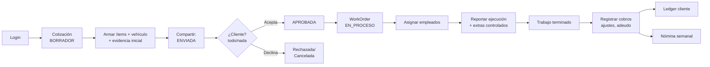

# SEBASAM — Sistema de diseño (Figma)

> Referencia visual: Figma `b3TlGONh5fTCNUilSHf75b`.
> Este documento traduce la línea visual de Figma a un contrato actionable para implementación en Next.js + Tailwind + Radix.

## Resumen

- Producto: sistema de gestión para taller (cotizaciones, órdenes de trabajo, clientes, pagos, nómina, inventario).
- Prioridad: **web mobile-first**; el uso principal es en celular.
- Tema: **Light por defecto** para operación y documentos; superficies **deep navy** para shell del dashboard, hero y estados de énfasis.
- Tipografía base: **Inter**; monoespaciado para folios, montos y datos de pago: **DM Mono**.
- Filosofía: los componentes nacen del flujo de negocio; no se inventan componentes genéricos sin contrato de datos.

## Tokens fundamentales

### Colores

| Token | Valor | Uso |
|---|---|---|
| `--color-primary` | `#004AAD` | Botones primarios, enlaces activos, énfasis operativo. |
| `--color-primary-hover` | `#003E91` | Hover de elementos primarios. |
| `--color-navy-700` | `#002B68` | Capas intermedias en modo oscuro/deep navy. |
| `--color-navy-800` | `#001B3F` | Surface en modo oscuro/deep navy. |
| `--color-navy-900` | `#001024` | Fondo deep navy, texto principal en light. |
| `--color-white` | `#FFFFFF` | Surface light, texto sobre fondos oscuros. |
| `--color-blue-tint` | `#E6F1FB` | Banners informativos, estados suaves, fondo de servicio en documento público. |
| `--color-on-navy-tint` | `#E6F1FB` | Texto/acento claro sobre superficies navy fijas en ambos modos. |
| `--color-bg-soft` | `#F3F6FA` | Fondo de pantalla en light. |
| `--color-border-light` | `#D7E0EA` | Bordes sutiles en light. |
| `--color-text-muted` | `#64748B` / `#6B7789` | Texto secundario, placeholders. |
| `--color-text-muted-fg` | `#475569` | Texto pequeño sobre superficies suaves cuando se necesita contraste AA. |
| `--gradient-primary` | `linear-gradient(90deg, #004AAD 0%, #001024 100%)` | Fondo oficial de botones primarios y acentos de marca. |
| `--gradient-primary-hover` | `linear-gradient(90deg, #003E91 0%, #001024 100%)` | Estado hover del gradiente primario. |

El gradiente primario es el patrón oficial para acciones primarias y acentos de marca; reemplaza el azul plano en botones `primary` y en heroes de documentos públicos. La base primaria sigue siendo `#004AAD` y el deep navy `#001024`.

### Modo claro y modo oscuro

El producto soporta ambos modos. Los tokens semánticos (`--color-background`, `--color-foreground`, `--color-surface`, `--color-text-main`, etc.) cambian de valor según la clase `light`/`dark` en `<html>`. El modo por defecto es **claro**.

| Token semántico | Modo claro | Modo oscuro | Uso |
|---|---|---|---|
| `--color-background` | `#F3F6FA` | `#001024` | Fondo de pantalla general. |
| `--color-foreground` | `#001024` | `#FFFFFF` | Texto principal sobre fondo base. |
| `--color-surface` | `#FFFFFF` | `#001B3F` | Tarjetas, paneles, inputs, diálogos. |
| `--color-bg-soft` | `#F3F6FA` | `#001024` | Fondos suaves, hover de filas. |
| `--color-border-light` | `#D7E0EA` | `#002B68` | Bordes y separadores sutiles. |
| `--color-blue-tint` | `#E6F1FB` | `#002B68` | Fondos de estado suave y botones secundarios. |
| `--color-text-main` | `#001024` | `#FFFFFF` | Títulos, labels, texto de alto énfasis. |
| `--color-text-muted` | `#64748B` | `#94A3B8` | Texto secundario, placeholders. |
| `--color-text-muted-fg` | `#475569` | `#CBD5E1` | Texto pequeño sobre superficies suaves. |

Reglas de contraste:
- En modo claro el texto oscuro (`#001024`) se usa sobre superficies blancas o azul-tinte.
- En modo oscuro el texto principal es blanco (`#FFFFFF`) y el texto secundario es gris azulado claro (`#94A3B8`).
- Los acentos semánticos mantienen su color base, pero en modo oscuro se prefiere la versión más luminosa para primer plano cuando el badge descansa sobre superficie navy (p. ej. verde `#4ADE80`, amarillo `#FCD34D`, rojo `#FCA5A5`, azul `#93C5FD`).
- Los estados de foco (`--shadow-focus`) se mantienen con el azul semitransparente para ambos modos.

### Acentos semánticos (estados / pagos)

| Token | Valor | Uso |
|---|---|---|
| `--color-status-success` | `#22C55E` | Pagado, completado, activo. |
| `--color-status-warning` | `#F59E0B` | Pendiente, parcial, vencido próximo. |
| `--color-status-danger` | `#EF4444` | Cancelado, error, vencido. |
| `--color-status-info` | `#004AAD` | En proceso, informativo. |

Regla de badges: fondo pastel con alpha bajo + borde con alpha medio + texto/dot en color sólido.

### Tipografía

| Estilo | Fuente | Peso | Tamaño | Interlineado |
|---|---|---|---|---|
| Display | Inter | Regular 400 | 28px | 1.1em |
| Title | Inter | Extra Bold 800 | 20px | 1.2em |
| Subtitle | Inter | Semi Bold 600 | 16px | 1.3em |
| Body | Inter | Regular 400 | 16px | 1.5em |
| Body sm | Inter | Regular 400 | 14px | 1.5em |
| Caption | Inter | Medium 500 | 12px | 1.2em |
| Mono body | DM Mono | Regular 400 | 14–16px | 1.5em |
| Mono display | DM Mono | Regular 400 | 18px | — |

### Espaciado y formas

| Token | Valor | Uso |
|---|---|---|
| `--space-xs` | 4px | Micro-ajustes. |
| `--space-sm` | 8px | Gap pequeño entre elementos relacionados. |
| `--space-md` | 16px | Padding de tarjetas, separación estándar. |
| `--space-lg` | 24px | Separación de secciones. |
| `--space-xl` | 32px | Separación de bloques grandes. |
| `--radius-sm` | 8px | Inputs, badges, chips pequeños. |
| `--radius-md` | 12–14px | Tarjetas, modales, bottom sheets. |
| `--radius-full` | 9999px | Badges, pills, avatares. |
| `--tap-min-height` | 44px | Altura mínima de controles tocables. |
| `--screen-padding-x` | 16px | Padding horizontal de pantalla. |

### Sombras

| Token | Valor | Uso |
|---|---|---|
| `--shadow-sm` | `0 1px 4px rgba(0,0,0,0.07), 0 1px 2px rgba(0,0,0,0.04)` | Tarjetas pequeñas, inputs enfocados. |
| `--shadow-md` | `0 4px 12px rgba(0,0,0,0.08), 0 2px 4px rgba(0,0,0,0.04)` | Tarjetas, dropdowns. |
| `--shadow-lg` | `0 8px 24px rgba(0,0,0,0.1), 0 4px 8px rgba(0,0,0,0.05)` | Modales, bottom sheets. |
| `--shadow-focus` | `0 0 0 3px rgba(30,77,140,0.18)` | Anillo de foco. |

## Componentes

### Base UI

Implementar como wrappers Tailwind sobre comportamiento nativo o Radix cuando se requiera accesibilidad avanzada.

| Componente | Notas de implementación |
|---|---|
| `Button` | Variantes: `primary`, `secondary`, `outline`, `ghost`, `danger`. Estados: `default`, `hover`, `disabled`, `loading`. Altura mínima 44px; la variante compacta (`h-9 / 36px`) solo se usa en contextos restringidos. El `primary` usa el gradiente de marca oficial. |
| `Input` | Label + input + helper + error. Bordes `#D7E0EA`, radio 10px, altura 44–48px. |
| `Textarea` | Mismo sistema que input; altura flexible. |
| `Checkbox` | Checkbox nativo estilizado o Radix Checkbox; label alineada. |
| `RadioGroup` | Radix RadioGroup; uso en listas cortas y filtros. |
| `Switch` | Radix Switch; preferencias y estados binarios. |
| `Badge` | Pill con fondo pastel; usado para estados. Tipografía Caption. |
| `Card` | Fondo blanco, borde sutil, radio 12–14px, padding 16–20px. |

### Wrappers sobre Radix

Estos componentes viven bajo `src/components/ui` y nunca exponen Radix directamente a las pantallas.

> **Regla del proyecto:** todas las pantallas deben consumir wrappers desde `src/components/ui`. No importar Radix directamente en pantallas, páginas o componentes de dominio; si un primitivo de Radix no está envuelto aún, crear el wrapper en `src/components/ui` antes de usarlo.

| Componente | Uso típico |
|---|---|
| `Select` | Listas desplegables de clientes, vehículos, estados, tipos de ítem. |
| `Dialog` | Confirmaciones, edición rápida, detalles. |
| `DropdownMenu` | Menús de acciones en tablas y tarjetas. |
| `Tabs` | Navegación de detalle de cotización: Resumen / Historial / Costos. |
| `Popover` | Paneles flotantes de filtros y ayuda. |
| `Tooltip` | Información contextual (p. ej. "ⓘ" en saldos). |
| `Accordion` | FAQ, secciones colapsables de documento público. |

### Componentes de dominio

| Componente | Responsabilidad |
|---|---|
| `QuoteOperationalBadge` | Mapea `EstadoCotizacion` a etapa humana: Pendiente / Aprobada / En proceso / Ajuste final / Cancelada. |
| `QuoteFinancialBadges` | Muestra estado de pago + factura. Solo Admin y Cliente. |
| `QuoteCard` | Resumen compacto de cotización para listados. |
| `QuoteTableRow` | Fila de tabla en dashboard admin. |
| `FilterBar` | Búsqueda + filtros de estado en listados. |

### Estados y carga

| Componente | Uso |
|---|---|
| `EmptyState` | Listados vacíos con icono, título y acción. |
| `LoadingSkeleton` | Placeholders de filas y tarjetas. |
| `ErrorState` | Error de carga con retry. |
| `Toast` | Confirmaciones y errores (Sonner o Radix Toast). |
| `Spinner` | Carga inline y de botón. |
| `Skeleton` | Bloques genéricos de carga. |

### Extensiones comunes

| Componente | Uso |
|---|---|
| `Label` | Etiqueta de campo. |
| `HelperText` | Texto de ayuda bajo un campo. |
| `ErrorText` | Texto de error bajo un campo. |
| `Avatar` | Iniciales de usuario/cliente. |
| `Divider` | Separación visual entre bloques. |
| `PaymentSummary` | Resumen de pagos/abonos/saldo. |
| `LedgerMovementRow` | Fila de movimiento de cuenta. |
| `TimelineItem` | Evento de evidencia/diagnóstico/nota. |
| `EvidenceCard` | Foto o archivo de evidencia. |
| `PayrollSummary` | Resumen de nómina por trabajador. |
| `StockBadge` | Indicador de existencia aproximada. |

### Constructor de cotización MVP

| Componente | Responsabilidad |
|---|---|
| `Stepper` | Indicador de pasos del flujo de cotización. |
| `BottomActionBar` | Barra fija inferior con acciones principales en móvil. |
| `BottomSheet` | Panel inferior para búsqueda y selección. |
| `SearchResultCard` | Resultado de búsqueda de cliente/vehículo. |
| `ClienteSearch` | Búsqueda y selección de cliente. |
| `ClienteCard` | Tarjeta de cliente seleccionado. |
| `UnidadCard` | Tarjeta de vehículo/unidad. |
| `PartidaCard` | Fila editable de partida de cotización. |
| `MaterialForm` | Formulario rápido de ítem tipo material. |
| `ManoObraForm` | Formulario rápido de ítem tipo mano de obra. |
| `ServicioExternoForm` | Formulario rápido de servicio externo. |
| `QuoteTotalsCard` | Subtotal / IVA / Total con toggle de IVA. |
| `QuoteNotesSection` | Notas internas y visibles para cliente. |
| `QuotePreviewCard` | Vista previa de cotización para compartir. |
| `PaymentLinkCard` | Tarjeta de datos de pago (CLABE, QR, WhatsApp). |

## Shell y navegación

- Mobile-first: bottom navigation de 3–5 items en móvil; sidebar colapsable en desktop.
- El shell es deep navy (`#001024`) con iconos y texto blanco/gris claro.
- Tap targets mínimos 44px; foco visible obligatorio.
- Rutas operativas protegidas; rutas públicas tokenizadas con `noindex`.

## Flujo de cotización y estados

Diagrama completo del flujo operativo, desde el login hasta el impacto en ledger y nómina:

### Estados operativos

| Estado | Significado | Quién lo dispara |
|---|---|---|
| `BORRADOR` | Cotización en construcción | Admin / asistente |
| `ENVIADA` | Cotización compartida al cliente | Admin al generar link/PDF |
| `APROBADA` | Cliente aceptó todo | Cliente vía link con token |
| `RECHAZADA` | Cliente declinó todo | Cliente vía link con token |
| `CANCELADA` | Admin cancela antes o después de enviar | Admin |
| `EN_PROCESO` | WorkOrder activa con empleados asignados | Sistema al aprobar |
| `AJUSTE_FINAL` | Extras o ajustes antes de cerrar | Admin / empleado autorizado |

### Reglas de diseño por estado

- `ENVIADA` se dispara al compartir URL pública o PDF.
- El cliente acepta o declina **todo/nada** mediante link con token expirable.
- `FACTURADA` no implica pagada; siempre se muestra el estado financiero aparte.
- El empleado **no ve** pagos, saldos, métodos de pago, factura ni ledger.

Las reglas de negocio completas viven en [`README.md`](./README.md#reglas-de-negocio-).

### Indicadores separados

1. **Operativo** (`QuoteOperationalBadge`): visible para Admin, Cliente y Empleado.
2. **Financiero / Documento** (`QuoteFinancialBadges`): solo Admin y Cliente.

## Pantallas por rol

### Admin

- Dashboard con resumen operativo.
- Listado de cotizaciones con búsqueda y filtros.
- Crear/editar cotización.
- Detalle de cotización (tabs: Resumen / Historial / Costos).
- Órdenes de trabajo: asignación, ejecución, cierre.
- Clientes: alta, búsqueda, edición, historial.
- Pagos / ledger / caja (post-MVP inmediato).
- Trabajadores y nómina (post-MVP inmediato).

### Cliente (portal público tokenizado)

- Ver cotización / orden de trabajo asignada.
- Aceptar o declinar cotización.
- Ver evidencia (fotos/diagnóstico) con URLs firmadas.
- Ver datos de pago fijos.
- **Fuera del MVP inmediato** según `docs/MVP_ISSUES.md`.

### Empleado

- Ver órdenes asignadas.
- Reportar ejecución y evidencia.
- Ver solo estado operativo y lo que impacta su nómina.
- **No ve** caja, pagos, saldos, métodos de pago, factura ni ledger.

## Documento público de cotización

- Header con gradiente de marca, logo/nombre y folio.
- Botones outline: "Contactar taller" y "Descargar".
- Bloque cliente/vehículo en grid de 2 columnas.
- Banner `SERVICIO` con fondo `#E6F1FB`.
- Tabla de conceptos: `Cant. / Concepto / Unitario / Importe`.
- Totales: Subtotal / IVA (si aplica) / Total grande en `#004AAD`.
- Card "Datos de pago" en deep navy con CLABEs en monospace y QR a `/pago`.
- No imprimir CLABEs directamente; usar URL + QR.

## Do's and Don'ts

- **Do** usar siempre tokens; no hardcodear colores fuera de tokens.
- **Do** mantener Radix debajo de `components/ui`; las pantallas consumen wrappers.
- **Do** separar estado operativo de estado financiero en la UI.
- **Do** respetar límites de visibilidad por rol.
- **Do** diseñar mobile-first y verificar tap targets ≥ 44px.
- **Don't** mostrar caja/pagos/ledger/factura al empleado.
- **Don't** inventar estilos visuales que no estén en Figma; si falta algo, agregar UI neutral funcional y anotar la discrepancia.
- **Don't** usar grises puros; preferir neutros con tinte azul.

## Notas de implementación

1. Instalar Radix primitives y Sonner como dependencias cuando se empiece la capa visual real.
2. Crear `components/ui` con wrappers tokenizados antes de tocar pantallas.
3. Usar `QuoteOperationalBadge` y `QuoteFinancialBadges` desde el primer listado de cotizaciones.
4. El schema actual en `prisma/schema.prisma` usa estados en inglés y separa `Quote`/`WorkOrder`; al implementar la UI, alinear los labels visuales con los estados de negocio documentados aquí.
5. El idioma operativo visible debe ser español de México; los identificadores técnicos permanecen en inglés.
