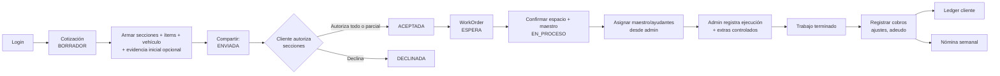

# SEBASAM Operations App

Aplicación operativa limpia para SEBASAM: cotizaciones, órdenes de trabajo, asignaciones y registro de ejecución. El objetivo del MVP es una PWA instalable en Android Chrome, no un APK.

## Resumen del proyecto

| Aspecto | Detalle |
|---|---|
| Propósito | Reemplazar búsquedas en archivos/PDF por una web app mobile-first donde los datos operativos vivan en base de datos. |
| Alcance implementado | Login admin, clientes, vehículos, cotizaciones en borrador, aprobación → orden de trabajo, `PaymentRequest`/`CustomerFiscalProfile`, PWA foundation. El acceso inmediato es **admin-led**: los trabajadores se gestionan como registros operativos desde el panel admin; no tienen login ni app propia en el MVP inmediato. |
| Referencia visual | Figma — ver [`DESIGN.md`](./DESIGN.md). |
| Referencia de dominio | `prisma/schema.prisma`, [`docs/ARCHITECTURE.md`](./docs/ARCHITECTURE.md) y este README. |
| Hosting objetivo | Landing pública en `sebasam.com`; app operativa independiente en `app.sebasam.com`. |
| Rutas objetivo | `/` es el hub role-aware post-login; `/login` es el único login; evitamos el namespace `/admin`. Ver [`docs/ARCHITECTURE.md`](./docs/ARCHITECTURE.md#hosting-y-modelo-de-rutas). |
| Modelo operativo objetivo | `Quote` y `WorkOrder` separados; el flujo pendiente debe soportar aceptación/autorización, autorización parcial por secciones, flujo de pago independiente, `ESPERA` antes de `EN_PROCESO` y trabajo urgente mediante autorización administrativa auditada. |
| Estado actual | Issues 1–7, 5.1 y 5.2 de [`docs/MVP_ISSUES.md`](./docs/MVP_ISSUES.md) completados; Issues 8–12 y el Issue GitHub #37 pendientes. Ver [`docs/MVP_STATUS.md`](./docs/MVP_STATUS.md). |

## Flujo operativo 🔄

Flujo operativo objetivo del MVP. La cotización se agrupa en secciones; el cliente puede autorizar una o más secciones sin autorizar la cotización completa. Si el cliente acepta por fuera del link (p. ej. teléfono), el admin debe poder autorizar la cotización con una nota obligatoria; la evidencia inicial es opcional. La aceptación o autorización no debe iniciar el trabajo inmediatamente: la orden debe pasar a `ESPERA` hasta confirmar espacio del taller y disponibilidad de maestro. La cobranza es un flujo financiero independiente: el personal define la preferencia de factura, captura o reutiliza los datos fiscales y elige el medio de cobro apropiado.



## Reglas de negocio 📋

| ID | Regla | Detalle |
|---|---|---|
| R1 | Estados de cotización objetivo | `BORRADOR` → `ENVIADA` → `ACEPTADA` / `DECLINADA`; el admin puede `CANCELADA` en cualquier momento permitido. Tras `ACEPTADA`, la orden debe pasar a `ESPERA` antes de `EN_PROCESO`. |
| R2 | Autorización por secciones | La cotización puede dividirse en secciones con subtotal propio. El cliente puede autorizar una o más secciones sin autorizar la cotización completa; las secciones no se modelan como cotizaciones separadas. |
| R3 | Token expirable | El link de cliente lleva token con vigencia; expirado → no se procesa la respuesta. |
| R4 | Aceptación/autorización → WorkOrder | Regla objetivo: toda orden de trabajo debe nacer de una cotización aceptada o autorizada administrativamente; debe crearse en `ESPERA` y pasar a `EN_PROCESO` al confirmar espacio y maestro. |
| R5 | Asignación controlada | Se asigna 1 maestro + N ayudantes desde el panel admin. En el MVP inmediato el registro es administrativo; el trabajador no tiene login/app propio. |
| R6 | Reporte de ejecución | El admin registra avance de ejecución empatado contra la cotización aceptada o autorizada administrativamente. Los registros se vinculan al trabajador para trazabilidad, nómina y cuenta del cliente. |
| R7 | Extras controlados | Los extras son posibles, pero requieren registro, control y quedan vinculados a la orden. |
| R8 | Fin de trabajo | El trabajo termina cuando la ejecución cubre el alcance aprobado + extras autorizados. |
| R9 | Cobros, ajustes y adeudo | Objetivo: registrar cada pago con método y monto; un pago parcial conserva el saldo pendiente. |
| R10 | Ledger del cliente | Objetivo: cada pago, ajuste o adeudo impacta el estado de cuenta del cliente. |
| R11 | Nómina semanal | La ejecución registrada alimenta el cálculo de nómina semanal. |
| R12 | Autorización administrativa | Regla objetivo: si el cliente aceptó por fuera del link (p. ej. teléfono), el admin debe marcar la cotización como autorizada con una nota obligatoria de canal/motivo. No es un flujo separado: usa el mismo registro de cotización/alcance. |
| R13 | Evidencia inicial | La evidencia inicial es opcional tanto en el borrador como en la autorización administrativa. |
| R14 | Subtotal y total pagable | Un subtotal general suma refacciones, mano de obra y servicios. Sin factura, `total pagable = subtotal`; con factura, `total pagable = subtotal + IVA`. |
| R15 | Conceptos financieros separados | Preferencia de factura, método de pago, estado de pago, estado de factura y saldo pendiente son conceptos independientes entre sí y del estado operativo. Facturada no significa pagada. |
| R16 | Responsabilidad fiscal interna | En el MVP, el personal define la preferencia de factura y captura o reutiliza `CustomerFiscalProfile`; el cliente no elige factura ni llena datos fiscales en la página pública. |
| R17 | Construcción por secciones desde el inicio | La experiencia de autor parte de una cotización con secciones. La acción principal es **Agregar sección**; dentro de cada sección se agregan conceptos con **Agregar concepto**. Los subtotales y el total se calculan automáticamente. Las acciones del cliente son **Autorizar sección** y **Autorizar cotización completa**. La agrupación retrospectiva de conceptos queda fuera del MVP inmediato. |
| R18 | Instrucciones públicas para transferencia | El link `/datos-de-pago/[token]` es opcional y exclusivo para transferencia: comunica un importe ya decidido, solo las cuentas elegibles y el contacto o envío de comprobante. No incluye selector de factura ni formulario fiscal. |

> **Terminología:** en la UI del cotizador cada línea se presenta como un **concepto** (acción **Agregar concepto**). En el modelo de dominio esa línea sigue siendo `QuoteItem`. Los tipos de concepto incluyen mano de obra, material, refacción, servicio externo y otro.

### Contrato de cobro y facturación

#### Cálculo y caminos principales

| Decisión interna | Fórmula del total pagable | Camino de cobro |
|---|---|---|
| Sin factura | `subtotal` | Efectivo, transferencia u otro método acordado. |
| Con factura | `subtotal + IVA` | El personal reutiliza o captura datos fiscales y preserva el snapshot de la transacción cuando aplica. |

El subtotal general incluye refacciones, mano de obra y servicios. El efectivo no requiere link ni cuentas bancarias: puede liquidar el total o registrar un abono parcial. La transferencia puede usar un `PaymentRequest` con importe decidido y una cuenta compatible con la preferencia fiscal.

#### Pagos parciales y cambio de factura

- Todo pago parcial deja un saldo pendiente asociado con la cuenta o ledger del cliente.
- La cotización muestra un indicador financiero de saldo pendiente separado de `QuoteStatus`; el estado operativo no representa cobranza.
- El cliente puede solicitar un cambio de preferencia de factura hasta la liquidación final. El personal ejecuta el cambio mediante recálculo controlado de IVA y total, confirmación con rastro de auditoría y actualización de las instrucciones de pago.
- El cambio de factura no es un toggle público silencioso.

#### Entidades y estados objetivo

`PaymentRequest` es una solicitud tokenizada de instrucciones para transferencia. No es un registro de pago, un movimiento de ledger ni una prueba de liquidación; el comprobante recibido tampoco aplica el pago por sí solo.

Los siguientes ejemplos pertenecen al dominio financiero objetivo y permanecen planificados mientras no existan sus entidades y persistencia:

| Concepto | Ejemplos objetivo |
|---|---|
| Método de pago | `CASH`, `TRANSFER`, `OTHER` |
| Estado de pago | `PENDING`, `PARTIAL`, `PAID` |
| Estado de factura | `NOT_REQUESTED`, `DATA_MISSING`, `READY`, `ISSUED` |
| Saldo pendiente | `total pagable - pagos aplicados` |

## Modelo de datos operativo 🗂️

Este es el modelo de dominio que soporta el flujo. Las primeras entidades existen en `prisma/schema.prisma`; las últimas tres son el objetivo para pagos, ledger y nómina.

| Entidad | Rol | Relación clave | Estado en schema |
|---|---|---|---|
| `UserProfile` | Usuarios internos: admin, asistente, empleado | Tiene `assignments` y `executionRecords` | ✅ Implementado |
| `Customer` | Cliente del taller | Tiene `quotes` y `vehicles` | ✅ Implementado |
| `Vehicle` | Unidad del cliente | Pertenece a `Customer`; referenciado por `Quote` | ✅ Implementado |
| `Quote` | Cotización comercial | Tiene `QuoteSection`s y `QuoteItem`s; origen de `WorkOrder` | ✅ Implementado |
| `QuoteSection` | Sección de cotización con subtotal propio | Pertenece a `Quote`; agrupa `QuoteItem`s | 🎯 Objetivo |
| `QuoteItem` | Concepto de cotización en UI (`QuoteItem`): material, mano de obra, refacción, servicio externo, etc. | Pertenece a `QuoteSection` y `Quote` | ✅ Implementado |
| `WorkOrder` | Orden de trabajo operativa | Implementado como orden vinculada a `Quote`; el flujo `ESPERA` y autorización administrativa auditada siguen pendientes | ✅ Implementado parcial |
| `WorkAssignment` | Asignación administrativa de empleado a orden | Vincula `UserProfile` y `WorkOrder`; el admin asigna maestro/ayudantes para accountability y cálculo de nómina | ✅ Implementado |
| `ExecutionRecord` | Registro administrativo de ejecución/reporte | Vincula `WorkOrder` y `UserProfile` opcional; el admin captura quién hizo el trabajo, cuándo y qué se ejecutó | ✅ Implementado |
| `CustomerFiscalProfile` | Perfil fiscal reutilizable del cliente | Permite captura interna y snapshot por transacción cuando aplica | ✅ Implementado |
| `PaymentRequest` | Solicitud tokenizada de instrucciones para transferencia | Vincula cliente y operación; controla token, vigencia, cancelación y datos fiscales asociados | ✅ Implementado |
| `Payment` | Cobro registrado por el admin | Pendiente: vincular `Quote` / `WorkOrder` y `Customer` | 🎯 Objetivo |
| `LedgerEntry` | Movimiento de estado de cuenta del cliente | Pendiente: refleja pagos, ajustes y adeudos | 🎯 Objetivo |
| `WeeklyPayroll` | Nómina semanal calculada | Pendiente: deriva de `ExecutionRecord` y `WorkAssignment` | 🎯 Objetivo |

## Documentos del proyecto

- [`docs/ARCHITECTURE.md`](./docs/ARCHITECTURE.md) — reglas de arquitectura, capas y dominio.
- [`docs/GITFLOW.md`](./docs/GITFLOW.md) — flujo de ramas y PRs.
- [`docs/AI_WORKFLOW.md`](./docs/AI_WORKFLOW.md) — protocolo de trabajo con asistentes de IA.
- [`docs/DATABASE_SAFETY.md`](./docs/DATABASE_SAFETY.md) — flujo seguro de migraciones y respaldos de `public`.
- [`docs/MVP_ISSUES.md`](./docs/MVP_ISSUES.md) — borrador de backlog del MVP (solo lectura; no mover ni renombrar).
- [`docs/MVP_STATUS.md`](./docs/MVP_STATUS.md) — estado actual del MVP y brechas pendientes.
- [`DESIGN.md`](./DESIGN.md) — sistema de diseño, tokens y componentes basado en Figma.

## Estado de implementación (resumen)

- [x] Setup del proyecto, Prisma + Supabase, login, sesión admin, perfiles/roles.
- [x] CRUD básico de clientes con búsqueda.
- [x] Entidad `Vehicle` vinculada a cliente; placas opcionales; snapshot en cotización.
- [x] Crear cotización borrador con ítems, totales calculados en servidor y validación Zod.
- [x] Aprobar cotización y crear `WorkOrder` transaccionalmente.
- [ ] Asignar `WorkOrder` y registrar ejecución desde el panel admin (admin-led; sin app de trabajador en el MVP inmediato).
- [x] Subtotal, IVA, total y vigencia de cotización calculados en servidor.
- [x] Base de `PaymentRequest`, `CustomerFiscalProfile`, snapshot fiscal y cuentas bancarias filtradas.
- [ ] Registros `Payment`, cobro parcial en efectivo, ledger del cliente, estados de pago/factura e indicador de saldo pendiente en la cotización.
- [ ] Ajustar `/datos-de-pago/[token]` al contrato de instrucciones exclusivas para transferencia, sin decisión fiscal pública.
- [ ] Definir el alcance final de la ruta genérica `/datos-pago`; no es la fuente autoritativa de instrucciones contextuales.
- [ ] Finalizar `WorkOrder` y generar PDF/salida final.
- [ ] Verificar instalabilidad PWA.
- [ ] Pipeline de despliegue en Vercel.
- [ ] Localización completa a español de México.
- [ ] Login/app de trabajador (`/mis-trabajos`, `/mi-nomina`) — post-MVP; ver GitHub #65.

---

## Ruta rápida ⚡

1. Copiar `.env.example` a `.env` y completar los valores de Supabase.
2. Instalar dependencias con `pnpm install`.
3. Generar Prisma Client con `pnpm prisma:generate`.
4. Correr localmente con `pnpm dev`.

## Reglas de arquitectura 🏗️

| Tema | Regla |
|---|---|
| Stack | Next.js App Router, TypeScript strict, Tailwind, Prisma, Supabase Postgres/Auth/Storage, pnpm. |
| Acceso a datos | Usar Prisma para datos operativos de negocio. No consultar las mismas tablas de negocio mediante helpers de Supabase client. |
| Auth | Usar Supabase Auth para sesiones. Guardar roles de app y datos de perfil en `UserProfile`. |
| Cotizaciones y órdenes | Estado actual: `WorkOrder` nace de `Quote` aprobada. Objetivo pendiente: soportar autorización administrativa auditada y `ESPERA` antes de `EN_PROCESO`. |
| Rutas y roles | `/` es el hub role-aware post-login; `/login` es el único login; evitamos el namespace `/admin`. Ver [`docs/ARCHITECTURE.md`](./docs/ARCHITECTURE.md#hosting-y-modelo-de-rutas). |
| Disciplina de deploy | `build` ejecuta `prisma generate && next build`. Las migraciones nunca se esconden dentro de `next build`. |
| Repositorio | Mantener este repositorio privado. |
| Ramas | Seguir el Gitflow pragmático de `docs/GITFLOW.md`. |

## Environment variables

| Variable | Purpose |
|----------|---------|
| `DATABASE_URL` | Supabase pooled Postgres URL for runtime. |
| `DIRECT_URL` | Supabase non-transaction URL for Prisma CLI migrations: Direct connection preferred, Session pooler accepted when Direct is unreachable. |
| `NEXT_PUBLIC_SUPABASE_URL` | Browser-safe Supabase project URL. |
| `NEXT_PUBLIC_SUPABASE_ANON_KEY` | Browser-safe Supabase anonymous key. |
| `SUPABASE_SERVICE_ROLE_KEY` | Optional server-only key. Never expose it as `NEXT_PUBLIC_*`. |

## Commands

```bash
pnpm dev
pnpm lint
pnpm typecheck
pnpm build
pnpm prisma:generate
pnpm db:migrate:dev
pnpm db:migrate:deploy
pnpm db:backup:public -- --destination /Volumes/SEBASAM-BACKUPS
pnpm db:seed
pnpm bootstrap:admin-profile
pnpm auth:set-password
```

## Internal Auth users

SEBASAM uses username-style login for staff, while Supabase Auth still stores email-based
identities internally. The visible username `pablo` maps to `pablo@sebasam.local`.

For the MVP, staff accounts are controlled internally. Do not enable public sign-up.

Create a new internal Auth user or reset an existing user's password with the local/admin script:

```bash
AUTH_USERNAME="pablo" \
AUTH_PASSWORD="temporary-password" \
SUPABASE_SERVICE_ROLE_KEY="<server-only-service-role-key>" \
pnpm auth:set-password
```

If the Auth user already exists, pass its UUID to reset the password:

```bash
AUTH_USERNAME="pablo" \
AUTH_PASSWORD="new-temporary-password" \
AUTH_USER_ID="<supabase-auth-user-uuid>" \
SUPABASE_SERVICE_ROLE_KEY="<server-only-service-role-key>" \
pnpm auth:set-password
```

The service role key is server-only. Never commit it, never expose it to browser code, and never
prefix it with `NEXT_PUBLIC_`.

## Admin profile bootstrap

Supabase Auth owns identity and sessions. Create the Auth user manually in Supabase first,
using the internal email that matches the visible login username, for example
`sebas@sebasam.local` for username `sebas`.

Then create or update the matching app profile with Prisma:

```bash
BOOTSTRAP_AUTH_USER_ID="<supabase-auth-user-uuid>" \
BOOTSTRAP_USERNAME="sebas" \
BOOTSTRAP_EMAIL="sebas@sebasam.local" \
BOOTSTRAP_DISPLAY_NAME="Sebas" \
BOOTSTRAP_ROLE="ADMIN" \
pnpm bootstrap:admin-profile
```

The bootstrap script does not create Supabase Auth users and does not need a service role key.
It only upserts `UserProfile` for an existing Auth user id. `BOOTSTRAP_ROLE` accepts `ADMIN`
or `ADMIN_ASSISTANT`.

Future admin password management can become an app screen, but it must use Radix primitives and
Tailwind wrappers derived from the Figma design system instead of invented visual styling.

## Deploy pipeline

1. Set `DATABASE_URL`, `DIRECT_URL`, and Supabase public env vars in the deploy environment.
2. Run `pnpm db:migrate:deploy` as an explicit release step.
3. Run `pnpm build` to generate Prisma Client and build Next.js.
4. Start with `pnpm start` or the hosting platform equivalent.

## What not to do

- Do not commit `package-lock.json`; this project uses pnpm.
- Do not rename env vars away from `.env.example` without updating Prisma and Supabase helpers.
- Do not run `prisma migrate dev` in production.
- Do not add migrations to `next build`.
- Do not import the schema from the other repository wholesale.
- Do not implement the tokenized customer portal in the initial MVP.
- Do not build a worker login or self-service app in the immediate MVP; worker records remain admin-managed. Ver GitHub #65.

## Reference

See:

- `docs/ARCHITECTURE.md` for the domain and layering rules.
- `docs/GITFLOW.md` for branch and PR workflow.
- `docs/AI_WORKFLOW.md` for AI assistant workflow, branch scope, commit discipline, and handoff rules.
- `docs/MVP_ISSUES.md` for the reviewable MVP issue backlog draft.
- `docs/MVP_STATUS.md` for the current gap analysis against the source MVP docs.
- `DESIGN.md` for the Figma-based design system.
