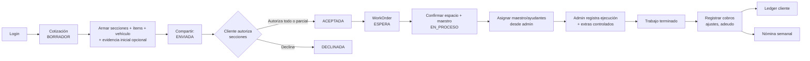

# Reglas de dominio y objetivos de producto

Referencia de las reglas de negocio acordadas. **No es una lista de funcionalidades pendientes ni evidencia de implementación.** Para el estado del código, consultá [arquitectura](./ARCHITECTURE.md); para ejecutar trabajo, usá el issue aprobado.

Las reglas R1–R18 y el flujo objetivo se conservan del README anterior. Los nombres de estado de negocio no equivalen automáticamente a enums de Prisma. Por ejemplo, `PaymentStatus` contiene `PENDING`/`PAID`; `PARTIAL` y los estados de factura de esta referencia son vocabulario de producto, no enums que se deban asumir existentes. Las diferencias entre objetivos y código se resuelven en issues, no cambiando comportamiento desde esta guía.

## Flujo operativo 🔄

Flujo operativo objetivo del MVP. La cotización se agrupa en secciones; el cliente puede autorizar una o más secciones sin autorizar la cotización completa. Si el cliente acepta por fuera del link (p. ej. teléfono), el admin debe poder autorizar la cotización con una nota obligatoria; la evidencia inicial es opcional. La aceptación o autorización no debe iniciar el trabajo inmediatamente: la orden debe pasar a `ESPERA` hasta confirmar espacio del taller y disponibilidad de maestro. La cobranza es un flujo financiero independiente: el personal define la preferencia de factura, captura o reutiliza los datos fiscales y elige el medio de cobro apropiado.

## Reglas de negocio 📋

| ID | Regla | Detalle |
|---|---|---|
| R1 | Estados de cotización objetivo | `BORRADOR` → `ENVIADA` → `ACEPTADA` / `DECLINADA`; el admin puede `CANCELADA` en cualquier momento permitido. Tras `ACEPTADA`, la orden debe pasar a `ESPERA` antes de `EN_PROCESO`. |
| R2 | Autorización por secciones | La cotización puede dividirse en secciones con subtotal propio. El cliente puede autorizar una o más secciones sin autorizar la cotización completa; las secciones no se modelan como cotizaciones separadas. |
| R3 | Token expirable | El link de cliente lleva token con vigencia; expirado → no se procesa la respuesta. |
| R4 | Aceptación/autorización → WorkOrder | Regla objetivo: toda orden de trabajo debe nacer de una cotización aceptada o autorizada administrativamente; debe crearse en `ESPERA` y pasar a `EN_PROCESO` al confirmar espacio y maestro. |
| R5 | Asignación controlada | Se asigna 1 maestro + N ayudantes desde el panel admin. En el MVP inmediato el registro es administrativo; el trabajador no tiene login/app propio. |
| R6 | Reporte de ejecución | El admin registra avance de ejecución empatado contra la cotización aceptada o autorizada administrativamente. Los registros se vinculan al trabajador para trazabilidad, nómina y cuenta del cliente. |
| R7 | Extras controlados | Los extras son posibles, pero requieren registro, control y quedan vinculados a la orden. |
| R8 | Fin de trabajo | El trabajo termina cuando la ejecución cubre el alcance aprobado + extras autorizados. |
| R9 | Cobros, ajustes y adeudo | Objetivo: registrar cada pago con método y monto; un pago parcial conserva el saldo pendiente. |
| R10 | Ledger del cliente | Objetivo: cada pago, ajuste o adeudo impacta el estado de cuenta del cliente. |
| R11 | Nómina semanal | La ejecución registrada alimenta el cálculo de nómina semanal. |
| R12 | Autorización administrativa | Regla objetivo: si el cliente aceptó por fuera del link (p. ej. teléfono), el admin debe marcar la cotización como autorizada con una nota obligatoria de canal/motivo. No es un flujo separado: usa el mismo registro de cotización/alcance. |
| R13 | Evidencia inicial | La evidencia inicial es opcional tanto en el borrador como en la autorización administrativa. |
| R14 | Subtotal y total pagable | Un subtotal general suma refacciones, mano de obra y servicios. Sin factura, `total pagable = subtotal`; con factura, `total pagable = subtotal + IVA`. |
| R15 | Conceptos financieros separados | Preferencia de factura, método de pago, estado de pago, estado de factura y saldo pendiente son conceptos independientes entre sí y del estado operativo. Facturada no significa pagada. |
| R16 | Responsabilidad fiscal interna | En el MVP, el personal define la preferencia de factura y captura o reutiliza `CustomerFiscalProfile`; el cliente no elige factura ni llena datos fiscales en la página pública. |
| R17 | Construcción por secciones desde el inicio | La experiencia de autor parte de una cotización con secciones. La acción principal es **Agregar sección**; dentro de cada sección se agregan conceptos con **Agregar concepto**. Los subtotales y el total se calculan automáticamente. Las acciones del cliente son **Autorizar sección** y **Autorizar cotización completa**. La agrupación retrospectiva de conceptos queda fuera del MVP inmediato. |
| R18 | Instrucciones públicas para transferencia | El link `/datos-de-pago/[token]` es opcional y exclusivo para transferencia: comunica un importe ya decidido, solo las cuentas elegibles y el contacto o envío de comprobante. No incluye selector de factura ni formulario fiscal. |

> **Terminología:** en la UI del cotizador cada línea se presenta como un **concepto** (acción **Agregar concepto**). En el modelo de dominio esa línea sigue siendo `QuoteItem`. Los tipos de concepto incluyen mano de obra, material, refacción, servicio externo y otro.

### Contrato de cobro y facturación

#### Cálculo y caminos principales

| Decisión interna | Fórmula del total pagable | Camino de cobro |
|---|---|---|
| Sin factura | `subtotal` | Efectivo, transferencia u otro método acordado. |
| Con factura | `subtotal + IVA` | El personal reutiliza o captura datos fiscales y preserva el snapshot de la transacción cuando aplica. |

El subtotal general incluye refacciones, mano de obra y servicios. El efectivo no requiere link ni cuentas bancarias: puede liquidar el total o registrar un abono parcial. La transferencia puede usar un `PaymentRequest` con importe decidido y una cuenta compatible con la preferencia fiscal.

#### Pagos parciales y cambio de factura

- Todo pago parcial deja un saldo pendiente asociado con la cuenta o ledger del cliente.
- La cotización muestra un indicador financiero de saldo pendiente separado de `QuoteStatus`; el estado operativo no representa cobranza.
- El cliente puede solicitar un cambio de preferencia de factura hasta la liquidación final. El personal ejecuta el cambio mediante recálculo controlado de IVA y total, confirmación con rastro de auditoría y actualización de las instrucciones de pago.
- El cambio de factura no es un toggle público silencioso.

#### Entidades y estados objetivo

`PaymentRequest` es una solicitud tokenizada de instrucciones para transferencia. No es un registro de pago, un movimiento de ledger ni una prueba de liquidación; el comprobante recibido tampoco aplica el pago por sí solo.

Los siguientes ejemplos conservan el vocabulario financiero objetivo. No implican que todas las entidades estén pendientes: `Payment` y `LedgerEntry` ya existen, mientras que los nombres persistidos y las diferencias con estos labels se consultan en [arquitectura](./ARCHITECTURE.md#modelo-y-estados-no-confundir-producto-con-enums):

| Concepto | Ejemplos objetivo |
|---|---|
| Método de pago | `CASH`, `TRANSFER`, `OTHER` |
| Estado de pago | `PENDING`, `PARTIAL`, `PAID` |
| Estado de factura | `NOT_REQUESTED`, `DATA_MISSING`, `READY`, `ISSUED` |
| Saldo pendiente | `total pagable - pagos aplicados` |

## Alcance e historial

El MVP original excluía el portal tokenizado de clientes. Esa exclusión describe el alcance inicial, no el estado actual: hoy existe `/cotizacion/[token]`. El self-service de trabajadores sigue siendo una propuesta distinta de los registros administrados internamente; no se habilita acceso por el solo hecho de existir `UserRole.WORKER`.

El historial de Git conserva los primeros snapshots del MVP; GitHub Issues es el tracker de ejecución vigente. Las especificaciones detalladas de correcciones y clientes están en [OpenSpec](../openspec/README.md).
